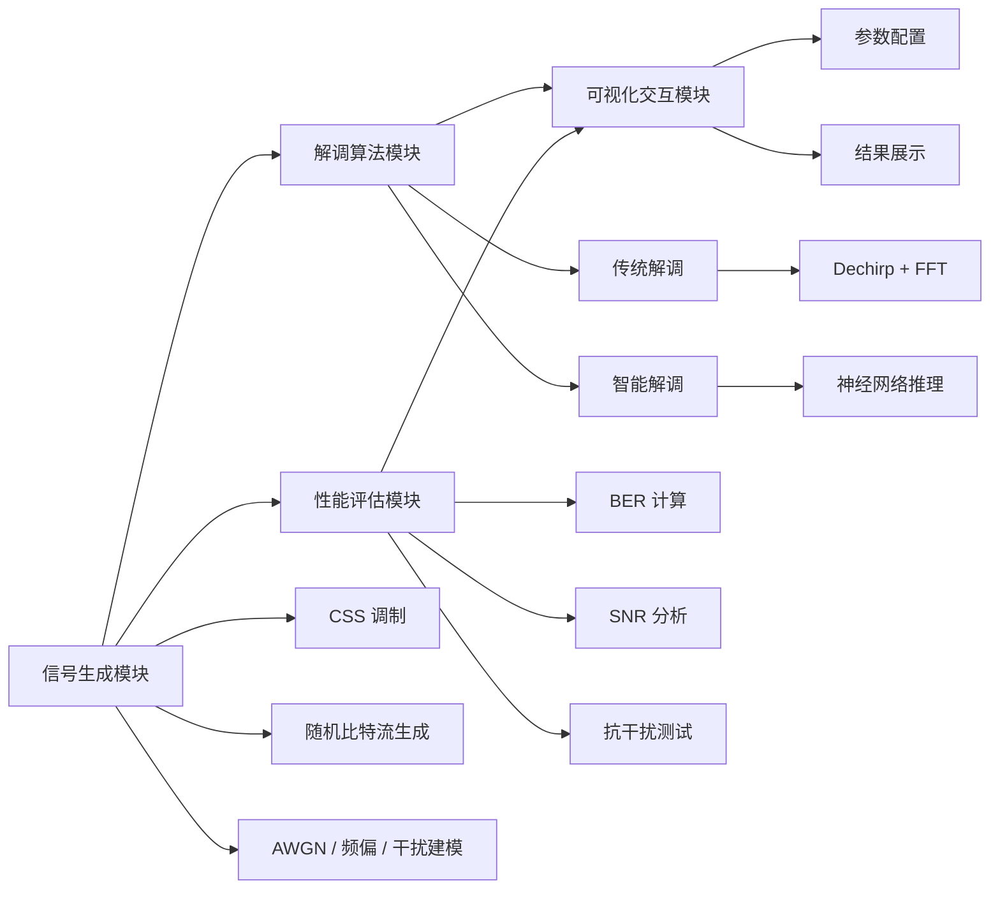

# 基于深度学习的 LoRa 信号智能解调系统

> 面向 LoRa（Long Range）通信场景的智能接收机研究与仿真平台

## 1. 项目简介

本项目围绕 LoRa 无线通信技术，研究基于深度学习的 Chirp Spread Spectrum（CSS，线性调频扩频）信号智能解调方法，并与传统解调算法进行性能对比。

项目整体目标是构建一个集 LoRa 信号生成、传统解调、神经网络智能解调和性能评估于一体的仿真系统。通过模拟不同信噪比（SNR）和干扰条件下的 LoRa 通信场景，分析传统解调与深度学习解调在误码率（BER）、抗干扰能力等方面的性能差异。

同时，项目将开发可视化交互界面，实现信号参数配置、算法选择、仿真运行和结果展示，为 LoRa 智能接收机算法研究提供实验平台。

### 项目定位

- 研究方向：LoRa 信号处理与智能接收
- 关键问题：在低 SNR 与复杂干扰环境下提升解调可靠性
- 主要方法：传统 DSP + 深度学习建模
- 目标应用：通信链路仿真、算法研究与实验验证

---

## 2. 项目研究目标

本项目主要完成以下四项研究任务：

### 2.1 LoRa CSS 调制解调原理与深度学习基础学习

- 学习 LoRa 通信系统基本原理
- 掌握 CSS 调制与解调机制
- 熟悉 LoRa 信号的时域与频域特征
- 学习神经网络基本原理及深度学习框架应用

### 2.2 LoRa 信号仿真生成与传统解调算法实现

- 搭建 LoRa 基带信号仿真模型
- 实现 CSS 调制与信号生成
- 模拟不同 SNR、频偏及干扰条件
- 实现基于 Dechirp + FFT 的传统解调算法

### 2.3 基于神经网络的智能解调算法设计

- 构建 LoRa 信号训练集与测试集
- 研究适用于信号特征提取的神经网络结构
- 设计并训练深度学习智能解调模型
- 优化网络结构及训练参数，提高复杂信道环境下的解调性能

### 2.4 解调算法性能对比

- 测试不同 SNR 条件下的误码率
- 测试不同干扰条件下的解调性能
- 对比传统解调与神经网络智能解调的性能差异
- 分析两种方法的适用场景及优劣

---

## 3. 预期成果

项目预期实现以下成果：

- 构建一套完整的 LoRa 信号仿真与智能解调系统
- 实现 LoRa CSS 信号生成与传统解调算法
- 实现基于神经网络的 LoRa 智能解调算法
- 建立不同信噪比和干扰条件下的性能测试体系
- 开发可视化交互界面，支持参数配置、算法运行及性能对比
- 绘制 BER-SNR 性能曲线，直观展示不同算法的解调性能

### 核心性能目标

在信噪比高于 10 dB 的测试条件下，力争将系统误码率（BER）控制在 10^-3 以下。

> 注：该指标为项目预期目标，实际性能需通过仿真实验验证，并明确调制参数、信道模型及干扰条件。

---

## 4. 系统总体架构

系统主要由五个模块构成，职责清晰，便于扩展和实验分析。



### 4.1 信号生成模块

负责生成 LoRa CSS 基带信号，并模拟真实无线通信环境。

主要功能：

- LoRa 参数配置
- 随机比特流生成
- CSS 调制
- AWGN 信道建模
- 频偏及干扰信号模拟

### 4.2 传统解调模块

实现基于经典数字信号处理方法的 LoRa 解调算法。

主要处理流程：

1. 接收 LoRa 信号
2. 与本地参考 Upchirp 进行去啁啾处理
3. 对去啁啾后的信号进行 FFT
4. 根据频谱峰值位置估计符号
5. 符号解映射，恢复原始比特流

### 4.3 智能解调模块

基于深度学习设计 LoRa 信号智能解调算法。

主要研究内容：

- 构建训练数据集与测试数据集
- 提取 LoRa 信号的时域或频域特征
- 设计神经网络模型
- 模型训练与参数优化
- 利用训练完成的模型进行信号分类与比特恢复

可探索的网络结构包括：

- CNN（卷积神经网络）
- RNN（循环神经网络）
- LSTM（长短期记忆网络）
- Transformer

### 4.4 性能评估模块

通过统一的测试数据和信道条件，对传统解调与智能解调算法进行公平对比。

主要评价指标：

- BER（Bit Error Rate）：误码率
- SER（Symbol Error Rate）：符号错误率
- SNR（Signal-to-Noise Ratio）：信噪比
- 抗干扰能力
- 算法运行时间及计算复杂度

### 4.5 可视化交互模块

开发图形化操作界面，提供以下功能：

- LoRa 信号参数配置
- 信噪比及干扰条件设置
- 信号生成与波形显示
- 传统解调算法运行
- 神经网络模型加载与推理
- BER-SNR 曲线绘制
- 不同算法性能对比
- 实验结果展示与保存

---

## 5. 技术路线

项目按照以下流程开展：

```text
LoRa CSS 原理学习
        ↓
LoRa 基带信号建模
        ↓
CSS 调制与信道仿真
        ↓
传统 Dechirp + FFT 解调
        ↓
神经网络数据集构建
        ↓
智能解调网络设计与训练
        ↓
不同信道条件下的性能测试
        ↓
传统算法与智能算法性能对比
        ↓
可视化交互系统开发
        ↓
系统测试与项目总结
```

---

## 6. 实验设计

为验证不同算法的性能，计划从以下几个方面开展实验：

### 6.1 不同信噪比下的性能测试

设置不同 SNR 条件，分别运行传统解调算法和神经网络解调算法，统计误码率，并以 BER-SNR 曲线形式展示结果。

### 6.2 不同干扰条件下的性能测试

考虑以下典型通信环境：

- AWGN 加性高斯白噪声
- 载波频率偏移（CFO）
- 同频窄带干扰
- 多径衰落（可选扩展）

分析不同干扰条件下两种解调方法的抗干扰能力。

### 6.3 算法性能对比

| 对比维度     | 传统解调      | 智能解调     |
| ------------ | ------------- | ------------ |
| 解调原理     | Dechirp + FFT | 神经网络推理 |
| 是否需要训练 | 否            | 是           |
| 低信噪比性能 | 实验测定      | 实验测定     |
| 抗干扰能力   | 实验测定      | 实验测定     |
| 计算复杂度   | 理论及实测    | 理论及实测   |
| 实时性       | 实验测定      | 实验测定     |

---

## 7. 开发环境与技术栈

项目计划采用以下技术路线：

| 技术方向   | 候选技术         |
| ---------- | ---------------- |
| 编程语言   | Python           |
| 数值计算   | NumPy、SciPy     |
| 信号可视化 | Matplotlib       |
| 深度学习   | PyTorch          |
| 数据处理   | NumPy、Pandas    |
| 交互界面   | Streamlit / PyQt |
| 版本管理   | Git              |

具体开发框架可根据实际实现情况调整。

---

## 8. 项目目录结构

```text
LoRa-Intelligent-Demodulation/
├── README.md                  # 项目说明文档
├── config/                    # 系统参数配置
│   └── config.yaml
├── data/                      # 数据集
│   ├── train/                 # 训练数据
│   ├── val/                   # 验证数据
│   └── test/                  # 测试数据
├── src/                       # 核心代码
│   ├── modulation/            # LoRa CSS 调制
│   ├── channel/               # 信道与干扰建模
│   ├── demodulation/          # 传统解调算法
│   ├── models/                # 神经网络模型
│   ├── training/              # 模型训练
│   └── evaluation/            # 性能评估
├── interface/                 # 可视化交互界面
├── experiments/               # 实验脚本
├── results/                   # 实验结果与图表
├── checkpoints/               # 模型权重
├── requirements.txt           # Python 依赖
├── main.py                    # 系统主入口
└── .gitignore
```

---

## 9. 项目进度规划

| 阶段     | 主要任务                        | 预期成果                 |
| -------- | ------------------------------- | ------------------------ |
| 第一阶段 | LoRa CSS 原理及深度学习框架学习 | 理论基础与开发环境       |
| 第二阶段 | LoRa 信号生成及传统解调实现     | 可运行的传统通信仿真链路 |
| 第三阶段 | 数据集构建及神经网络设计        | 可训练的智能解调模型     |
| 第四阶段 | 模型训练与性能对比实验          | BER-SNR 曲线及实验报告   |
| 第五阶段 | 可视化交互界面开发              | 完整仿真系统             |
| 第六阶段 | 系统测试与优化                  | 项目最终成果             |

---

## 10. 项目特色

- 传统算法与深度学习相结合：以经典 CSS 解调算法为基准，探索神经网络在 LoRa 接收机中的应用
- 多信道环境仿真：支持不同信噪比、频偏及干扰条件下的通信性能测试
- 量化性能评估：通过 BER、SER 等指标客观评价不同解调算法的性能
- 可视化交互设计：将信号生成、算法运行和性能分析集成到统一平台
- 模块化系统架构：各功能模块相互独立，便于后续算法扩展和系统优化

---

## 11. 参考资料

- Semtech LoRa 技术文档及相关芯片数据手册
- LoRa CSS 调制解调相关学术论文
- 深度学习与无线通信信号处理相关研究文献
- PyTorch 官方文档：https://pytorch.org/docs/
- NumPy 官方文档：https://numpy.org/doc/

---

## 12. 项目说明

本项目主要用于 LoRa CSS 信号处理、传统解调算法与深度学习智能解调算法的仿真研究。

当前项目处于开发阶段，具体算法实现、实验结果及性能指标将随着项目推进逐步完善。
